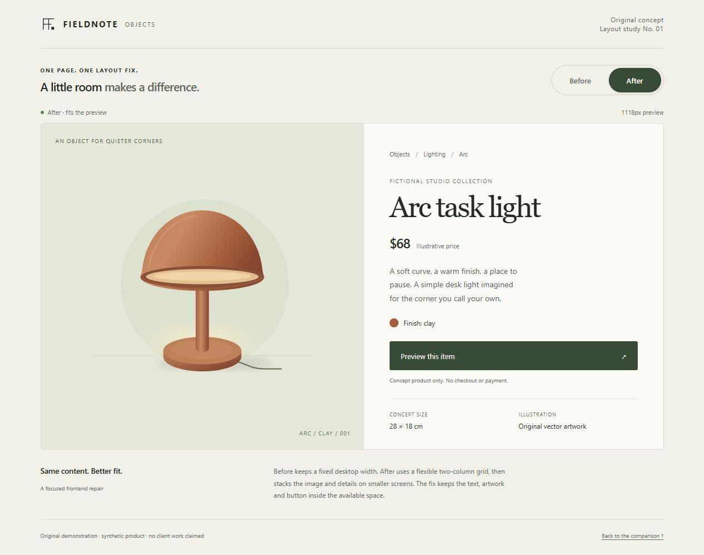

# Responsive product layout demo

An original, self-contained frontend repair demonstration. The brand, lamp, price and dimensions are fictional. The inline SVG is original artwork. This is a sample, not a client project, customer result or functioning shop.

Open `index.html` in a browser. No installation, build, server or account is needed.

## What was checked

The page was rendered in the Codex in-app browser through a temporary local server. At a 390px viewport, **Before** produced a 960px-wide card inside a 333px preview. **After** fit the same preview without horizontal overflow. The repaired layout also fit at 320, 760, 768 and 1280px viewport widths.

Enter and Space changed the selected layout, Tab produced a visible 3px focus outline, and the item button displayed its concept-only confirmation. These are checks of this standalone sample; no WordPress or Shopify installation was tested.

- [Actual geometry and source fingerprint](evidence/browser-check.json)
- [Mobile before](evidence/mobile-before.jpg) / [mobile after](evidence/mobile-after.jpg)

## The ticket

**Problem:** a product card has a fixed 960px desktop width. On a narrow screen, the image pushes the product details and action outside the visible preview.

**Fix:** a fluid grid with `minmax(0, …)` tracks and `min-width: 0` children. Below 760px the card becomes a single column. The artwork scales to its container.

The **Before / After** buttons switch the actual layout rules on the same product card. Before intentionally overflows inside a horizontally scrollable preview; the outer page and comparison controls stay usable. After is the default.

## Browser acceptance checks

1. At a 390px viewport, choose **Before**. The status reports horizontal overflow. Scroll the product preview horizontally to see the details.
2. Choose **After**. The image and details stack, the entire action fits, and the status reports that the content fits. The preview returns to its left edge.
3. Repeat at 320px, 760px, 768px and a desktop width. After should not create horizontal page or preview overflow. At desktop widths, it has two columns.
4. Use Tab, Enter and Space to operate the comparison and item button. Focus is visible; the selected comparison button exposes `aria-pressed`. A skip link is available at the beginning of the page.
5. Select **Preview this item**. An inline message confirms that nothing has been ordered. There is no checkout.

The status and preview width are measured from the current rendered container. The checks above were run in one browser engine; other browsers and an actual store integration remain outside this sample.

## Boundaries

- Two files; native HTML, CSS and JavaScript only.
- No external fonts, images, libraries, services or network requests.
- No tracking, cookies, local storage, personal data, email addresses or payment details.
- No ratings, sales claims, testimonials or fabricated commercial history.
- No ordering, payment, backend, inventory or ecommerce platform.

This repository contains the complete standalone sample and its verification evidence. There is no hosted shop or checkout service.
