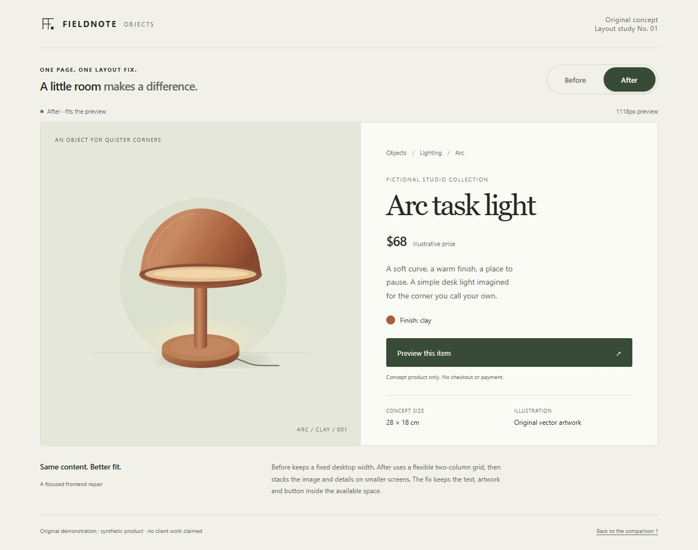

# 商品卡窄屏排版

打开这一页，可以对比同一张商品卡在改前和改后的排版。改前卡片固定 960px 宽，窄屏上图片会把说明和按钮挤到预览外面，需要左右滑动才能看完。改后用弹性网格，小于 760px 时改成单列，内容会收进预览框里。

**[打开在线对比页](https://yueyue673.github.io/responsive-ticket-demo/)**

也可以直接打开 `index.html`。不用安装，不用服务器，不用账号。

## 怎么对比

页面上的 **Before / After** 会切换同一张卡片的样式。Before 会在预览里横向溢出，外面的页面和切换按钮仍可正常使用。打开后默认是 After。

1. 把窗口或预览调到约 390px 宽，点 Before。状态会提示横向溢出。左右滑动预览，才能看到商品说明。
2. 再点 After。图片和说明上下排，按钮也能看见，状态提示内容已放下。预览会回到最左边。
3. 再试试 320px、760px、768px 和桌面宽度。After 不应让页面或预览横向溢出。桌面宽度下是两列。
4. 用 Tab、Enter、空格操作切换按钮和商品按钮。焦点有 3px 的可见描边；选中的对比按钮带 `aria-pressed`。页头有跳到对比的链接。
5. 点 **Preview this item**，页面会提示没有下单。这里没有结账。

## 实际量过的结果

曾在 Codex 内置浏览器里，用临时本地服务打开这一页。390px 视口时，Before 在 333px 的预览里出现一张 960px 宽的卡片；After 能放下，没有横向溢出。After 在 320、760、768、1280px 视口也能放下。

Enter 和空格可以切换对比，Tab 能看到 3px 焦点描边，商品按钮会显示并未下单的提示。

- [测量数据和源文件指纹](evidence/browser-check.json)
- [手机改前](evidence/mobile-before.jpg) / [手机改后](evidence/mobile-after.jpg)

以上是在一个浏览器引擎里核对的。没有接到 WordPress 或 Shopify 上试过，其他浏览器也还没测。

## 改了什么

问题：商品卡写死 960px 宽。窄屏上图片把说明和按钮推到预览外面。

改法：用带 `minmax(0, …)` 的弹性网格，子项加 `min-width: 0`。小于 760px 时改成单列，插画随容器缩放。

样式和脚本都写在 `index.html` 里。没有外部字体、图片或库，也不会发网络请求。卡片里的灯、价格和尺寸是示例。

English

This page compares the same product card before and after a layout fix. Before, the card is a fixed 960px wide and overflows a narrow preview. After, a fluid grid stacks the image and details below 760px.

Open the [live comparison](https://yueyue673.github.io/responsive-ticket-demo/) or the local `index.html`. No install or server is needed. Use the Before / After buttons, then try 320, 390, 760, 768 and 1280px widths. At a 390px viewport, Before produced a 960px-wide card inside a 333px preview; After fit without horizontal overflow.

